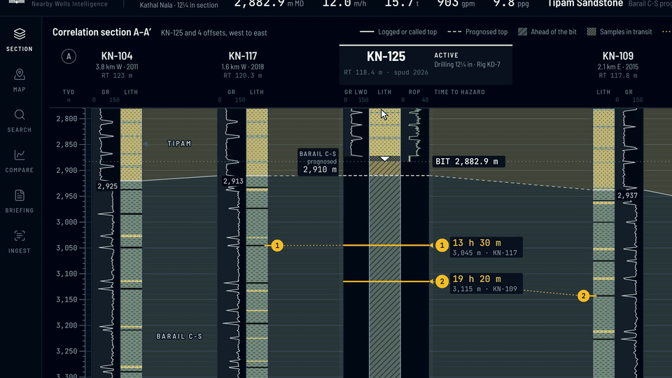

# N-W-I-S, Offset-well memory

Oil India Limited. Team 1, Saveetha Engineering College.

Offset-well memory for the active well.
Alerts are tied to formations, re-tie live when the actual top differs from the
prognosis, and open the report page they came from.



Status. Target product and working prototype on synthetic Upper Assam data.
The parser has run on the demo pack's 926 synthetic daily reports, 189 pages of them by OCR.
The run on Equinor's public Volve reports is scripted in `data/volve/` and not done yet.
Not deployed at OIL.

Quick start: `make demo`, then open http://localhost:3000

---

## What it does

| Screen | What you see |
|---|---|
| Section | KN-125 between four offsets, tops tied, offset events placed by formation, time to hazard at the current ROP, the recommendation card |
| Drawer | The offset event, its mud weight and action, the daily report page with the parsed passage highlighted, extraction confidence |
| Map | Barail structure contours, the F1 fault, a radius ring you set, offsets ranked by geological similarity with distance second |
| Search | A plain-English question read into filters, parsed events with page citations, sortable loss rate and mud weight |
| Compare | Days versus depth for the offsets and KN-125's plan with NPT bubbles, casing and mud programs side by side |
| Briefing | The pre-spud offset review by hole section, every line cited, editable, exported to PDF |
| Ingestion | Parse counts, confidence histograms, accuracy against ground truth, and the review queue in front of the alerts |

The hero: the mud logger calls the Barail top at 2,872 m against a prognosis of 2,910 m.
The section re-hangs every top below the call, the alerts slide up 38 m, and the KN-117 caving goes from 13 h 30 m in Watch to 10 h 20 m in Prepare.

## Run it

You need Node 22 or later, pnpm 10, [uv](https://docs.astral.sh/uv/) and Tesseract (`brew install tesseract` or `apt install tesseract-ocr`).

```
make demo          # installs, builds the demo pack if missing, starts API and web
```

Or step by step.

```
pnpm install
uv sync --all-packages
make data          # generator -> 926 report PDFs -> parser, about a minute
pnpm dev           # API on :8121, web on :3000 (dev); `pnpm start` serves the production build
```

The four section wells' reports are committed under `data/demo/ddr/`; `make data` renders the other twenty.

## Checks

```
pnpm typecheck     # correlate, synth, recording and web
pnpm lint          # ESLint and ruff
pnpm test          # vitest and pytest
pnpm build         # production build of the web app
```

CI runs the same in `.github/workflows/ci.yml`.

## The video

One example, start to finish, in 1:19: alert 1 on KN-125, from the mud-logger call through the re-tie
to the KN-117 report page and back to the recommendation.
The map, search, comparison, briefing and ingestion screens are in the app, not in the video.

```
pnpm start                         # API and the production web build, in one terminal
WELLS_URL=http://localhost:3000 pnpm film   # writes recording/out/demo.mp4
```

`recording/storyboard.ts` holds the scenes, their timings and the voiceover lines.
`recording/film.ts` plays them on a fake clock, one frame at a time, at 1600 by 900 and 2x, and exports 1920 by 1080.
It stops if a number the voiceover speaks is not on screen at that moment.
`recording/voiceover.md` is written from the same table, so its timings match the MP4.

## Repository

```
apps/web/            Next.js App Router, Tailwind, shadcn/ui: every screen
apps/api/            FastAPI: wells, events, replay, search, document pages, review, briefing export
packages/correlate/  formation tie, re-tie, projection, ETA and bands, recommendation, analogues, briefing
packages/synth/      seeded field, drilling histories, daily reports, replay; ddr/ renders them to PDF
packages/extract/    report parser: text layer, Tesseract OCR, incidents, lessons, WITSML for Volve
data/demo/           the generated pack, parsed events and the four section wells' reports
data/volve/          the Volve run, not done yet
recording/           storyboard, film and still scripts, the MP4, the voiceover
docs/                architecture, data model, alert logic, synthetic data
```

Read [docs/synthetic-data.md](docs/synthetic-data.md) for exactly what is real and what is not.

## Licence

MIT, see [LICENSE](LICENSE).
Formation names follow USGS Bulletin 2208-D.
The Volve data, once used, is under the Equinor Open Data Licence and stays out of this repository.
