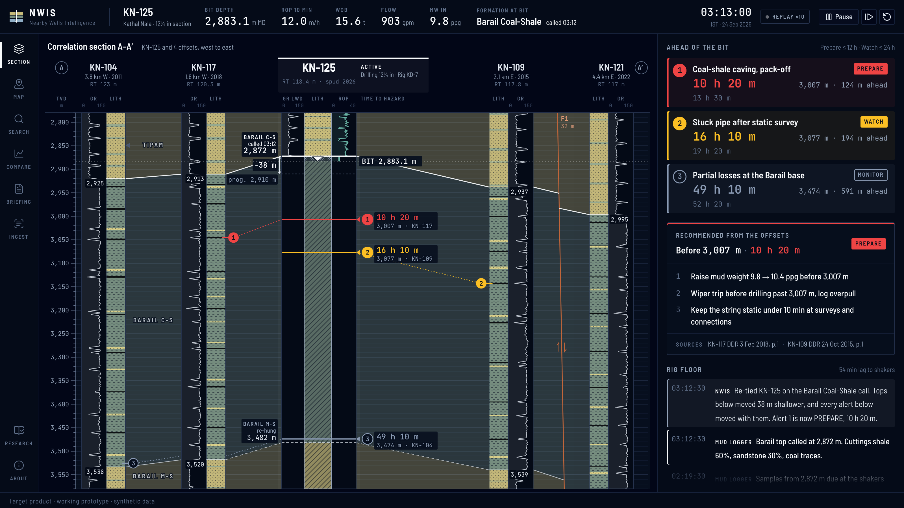

# N-W-I-S

Offset-well memory for the well being drilled.



Every incident in the offset wells' daily reports is placed on the active well by the rock layer it happened in.
When the mud logger calls a top off the prognosis, the section re-ties, and every alert below it is re-timed at the live rate of penetration.
Each alert opens the report page it came from, read by OCR, with the sentence behind it highlighted.

| Run | Result |
|---|---|
| Parser on the demo pack | 926 daily reports, 190 scanned pages read by Tesseract, 118 of 120 planted incidents found |
| Hazard rules on real reports | 1,759 daily reports from Equinor's Volve field, 379 hazards found, 91 of 100 right when checked by hand |

The field is fictional and the wells are synthetic, drawn on real Google satellite terrain in Upper Assam.
This is a working prototype, not deployed at Oil India.

## Install

You need Node 22 or later, pnpm 10, [uv](https://docs.astral.sh/uv/) and Tesseract.

```
make setup     # pnpm install, then uv sync --all-packages
```

## Run

```
make demo      # installs, builds the demo pack, opens on :3000
```

Only four wells' report PDFs are committed.
When the rest are missing, `make demo` first runs `make data`, which regenerates the pack from seed 26121, renders every report to PDF and parses them back.
Then it runs `pnpm dev`.
`pnpm dev` starts the API on :8121 and the web app on :3000 together, and Ctrl-C stops both.
`pnpm start` does the same with the production build from `pnpm build`.

The flight to the field needs a Google Maps key with the Maps JavaScript and Map Tiles APIs, set as `NEXT_PUBLIC_GOOGLE_MAPS_API_KEY` in `apps/web/.env.local`.
Without one, the app opens on the field and every other screen works.

### With Docker

```
docker compose up --build
```

This builds the API and the web app from the one `Dockerfile` and serves them on :8121 and :3000.
The images carry the committed demo pack, so report pages open for the four section wells and answer 404 for the rest until `make data` has rendered them.
Put the Maps key in `.env` as `NEXT_PUBLIC_GOOGLE_MAPS_API_KEY` to build it into the web image.

### Configuration

Every environment variable is optional, and an empty value means the default.
[.env.example](.env.example) lists them all with their defaults, and [apps/web/.env.example](apps/web/.env.example) lists the browser-side ones.

| Variable | Read by | Default |
|---|---|---|
| `WELLS_DATA_DIR` | API, web server | `data/demo` in this checkout |
| `WELLS_API_URL` | web server | `http://127.0.0.1:8121` |
| `NEXT_PUBLIC_API_URL` | browser | `http://localhost:8121` |
| `NEXT_PUBLIC_GOOGLE_MAPS_API_KEY` | browser | none, the app falls back to the drawn contour map |
| `WEB_PORT` | `pnpm dev`, `pnpm start` | `3000` |
| `WELLS_LOG_LEVEL` | API | `INFO` |
| `WELLS_SENTRY_DSN` | API | none, unhandled errors are only logged |
| `WELLS_CORS_ORIGINS` | API | any origin; a comma-separated list limits browser calls to those sites |
| `NEXT_PUBLIC_BRAND`, `NEXT_PUBLIC_BRAND_TAGLINE`, `NEXT_PUBLIC_BRAND_LABEL` | browser | `N-W-I-S`, `Offset-well memory`, `Oil India Limited` |
| `WELLS_PROD` | `pnpm dev` | unset, `pnpm start` sets it to serve the production build |

## Test

```
pnpm test      # vitest, then pytest
pnpm test:cov  # vitest with v8 coverage
```

pytest measures coverage on every run and fails under 80%.
vitest fails under 85% of lines with `pnpm test:cov`.
The OCR tests need Tesseract on the path.

`pnpm typecheck`, `uv run mypy`, `pnpm lint`, `pnpm test` and `pnpm build` run the same checks as CI, and `make check` runs them all.
CI also audits both lockfiles with `pnpm audit` and pip-audit, scans the history with gitleaks, and starts the compose stack.
A weekly `fresh clone` workflow deletes the committed pack, runs `make setup` and `make data`, checks the parser still finds the planted incidents, and runs every test.

## Architecture

```
apps/web/            every screen, in Next.js and Tailwind
apps/api/            FastAPI over the demo pack and the parsed reports
packages/correlate/  formation tie, re-tie, time to hazard, recommendation
packages/extract/    report parser: text layer, OCR, incidents, hazard rules, Volve
packages/synth/      seeded field, drilling histories, daily reports rendered to PDF
recording/           the demo video, scripted frame by frame
docs/                architecture, alert logic, data model, synthetic data, prior work
```

The generator writes the field and the reports, the renderer turns the reports into PDFs, and the parser reads them back into events with page citations.
The API serves those events, the report pages and the OCR word boxes.
The web app runs the correlation logic in the browser, so the re-tie animates.
[docs/architecture.md](docs/architecture.md) walks through the pipeline, the routes and the arrival.

The API's `main.py` builds the app, and its routes sit in `apps/api/wells_api/routes/`, one module each for wells, documents, review and briefing.
Each route gets the pack through the `StoreDep` dependency in `store.py`, so a test can swap the pack with `app.dependency_overrides`.

The API logs each request as one JSON line with a request id, which it also returns in `X-Request-ID`.
`GET /health` reports the pack's seed and counts, and answers 503 when the demo pack is missing.
The web server has its own `GET /api/health`, which answers 503 without the pack and reports whether it can reach the API, and docker compose waits on both.
`GET /metrics` serves Prometheus counters and latency histograms per route template, plus a count of unhandled errors.
With `WELLS_SENTRY_DSN` set, each unhandled error also goes to Sentry, tagged with its request id.
A request body over 1 MiB gets 413 before any route reads it.
The web server writes each error it hits while rendering a page or running a route as one JSON line on stderr, in the API's log shape, with the caller's request id and the digest shown on the error page.
The API reads and checks its settings once at startup in `apps/api/wells_api/config.py`, and an unknown `WELLS_LOG_LEVEL` stops it with an error naming the variable.

[docs/synthetic-data.md](docs/synthetic-data.md) says exactly what is real and what is not.

Team 1, Saveetha Engineering College.
MIT licence.
Formation names follow USGS Bulletin 2208-D.
The Volve reports are Equinor's, under the Equinor Open Data Licence.
